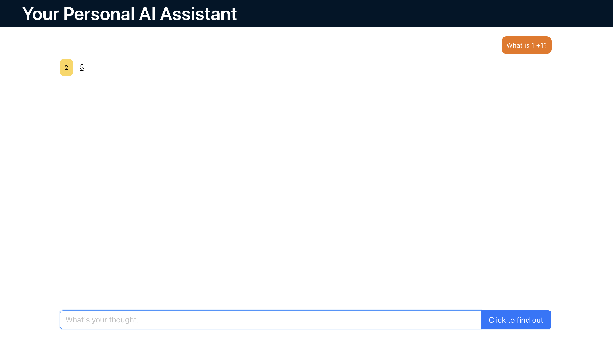

**Personal AI Assistant**

A full-stack AI assistant built with React, Node.js, Express, and the OpenAI API. The project provides an interactive chat interface and explores voice-related features, including text-to-speech.

**Features**

--AI Chatbot: Interact with an AI assistant through a chat interface.

--Text-to-Speech: Explore voice output to make interactions more accessible and engaging.

--Voice Features: Includes additional voice-related functionality.

**Tech Stack**

Frontend

  --React

  --JavaScript

Backend

  --Node.js

  --Express.js

AI Integration

  --OpenAI API

  --LangChain
